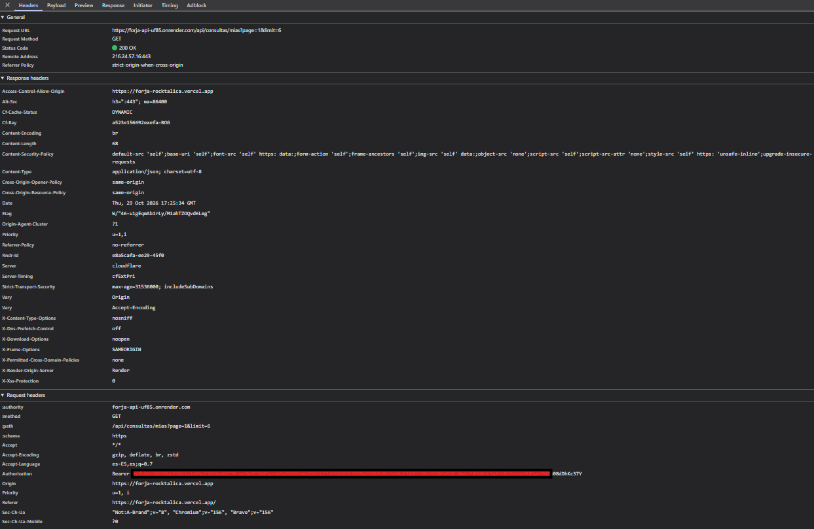

# Forja Rocktalica · Web

Sitio web de **Forja Rocktalica**, la tienda de instrumentos y equipos para rock y metal de la Entrega 1, reconstruido en Next.js y conectado a una API propia con usuarios, roles y base de datos.

- 🌐 Sitio desplegado (Vercel): https://forja-rocktalica.vercel.app
- 🔌 API desplegada (Render): https://forja-api-uf85.onrender.com
- 📦 Repositorio de la API: https://github.com/Santi-a-ux/Forja-Rocktalica-backend

**Stack:** Next.js (App Router) · TypeScript · Tailwind CSS v4

## Organización por features

```
app/                       rutas (page.tsx): solo componen
src/features/
├── common/                config.ts, http.ts (token + manejo del 401), Navbar, Pagination, Field, Estados...
├── auth/                  domain · services · hooks (useAuth) · components (LoginForm, RegisterForm, RutaProtegida)
├── instrumentos/          catálogo público + panel de administración
├── marcas/                fichas de las marcas
└── consultas/             formulario de contacto, "Mis consultas" y consultas del admin
```

Ningún componente llama a `fetch`: todo pasa por `services/` y los componentes usan `hooks/`.

## Correrlo en local

Requisitos: Node 20+ y la API corriendo (ver el README del repositorio de la API).

```bash
npm install
cp .env.example .env.local     # y revisa NEXT_PUBLIC_API_HOST
npm run dev                    # http://localhost:3000
```

Las fotos del catálogo ya están en `public/img/` (la API guarda rutas como `/img/fender-stratocaster.jpg`).

| Variable | Descripción |
|----------|-------------|
| `NEXT_PUBLIC_API_HOST` | URL base de la API, sin `/api` al final (`http://localhost:4000` en local; la URL de Render/Railway en producción) |

## Credenciales de prueba (creadas por el seed de la API, solo para el ambiente de la entrega)

| Rol | Correo | Contraseña |
|-----|--------|------------|
| admin | `admin@forja.com` | `Admin12345` |
| user | `user@forja.com` | `User12345` |

## Despliegue en Vercel

1. Importa este repositorio en Vercel. Como el proyecto venía del sitio estático de la Entrega 1, en *Settings → Build and Deployment* hay que poner el **Framework Preset en Next.js** (con los *Override* de comandos apagados).
2. En *Environments → Production* agrega la variable `NEXT_PUBLIC_API_HOST` con la URL de la API en producción (`https://forja-api-uf85.onrender.com`, sin `/api` ni `/` al final).
3. Redespliega: la variable solo se aplica al reconstruir el sitio. Después, cada push a `main` actualiza el sitio.
4. En Render, pon el dominio principal del sitio (`https://forja-rocktalica.vercel.app`, sin `/` final) en la variable `CORS_ORIGIN` de la API. Hay que entrar siempre por ese dominio: la API rechaza las URLs largas de cada despliegue.

## Decisiones técnicas

### Flujo completo de un login

1. **Formulario:** El usuario ingresa sus credenciales en `LoginForm.tsx` y envía el formulario.
2. **Petición HTTP:** Se llama a `authService.login()`, enviando una solicitud `POST` a `/api/auth/login` con el payload JSON.
3. **Validación Backend:** El servidor busca la cuenta por correo, valida el hash de la contraseña usando `bcrypt.compare` y genera un JSON Web Token (JWT) firmado con `JWT_SECRET`.
4. **Recepción y Almacenamiento:** El frontend recibe el objeto con el usuario y el token. La función `setToken()` almacena el token en `localStorage` bajo la clave `forja-token`.
5. **Estado Global:** `AuthProvider` actualiza el estado reactivo global con la información del usuario autenticado y su rol.
6. **Peticiones Subsecuentes:** En peticiones a rutas protegidas (como `/api/consultas/mias`), el cliente HTTP centralizado (`src/features/common/http.ts`) recupera el token de `localStorage` y lo inyecta automáticamente en el encabezado `Authorization: Bearer <token>`.
7. **Verificación:** El backend valida la firma del token mediante el middleware `autenticacion.ts` y autoriza la entrega de los datos.
8. **Si el token falla:** cuando la API responde `401` (token expirado o inválido), `http.ts` borra el token, cierra la sesión en el estado global y envía al usuario a `/login`.

### ¿Dónde guardas el token y qué riesgo tiene?

El token se almacena en `localStorage` con la clave `forja-token`.

- **Riesgo:** Los datos almacenados en `localStorage` son accesibles desde cualquier script de JavaScript que se ejecute en el mismo dominio. Si la aplicación llega a ser vulnerable a un ataque de Cross-Site Scripting (XSS), un script malicioso podría leer `localStorage.getItem('forja-token')` y robar el token de sesión.
- **Alternativa Segura:** Implementar cookies con directivas `httpOnly`, `Secure` y `SameSite`. Al ser `httpOnly`, el navegador adjunta la cookie automáticamente en cada petición pero prohíbe su acceso desde el código JavaScript, mitigando el riesgo de exfiltración por XSS.

### ¿En qué caso 401 y en cuál 403?

- **401 Unauthorized:** Ocurre cuando la identidad del usuario no está autenticada (no se envió token, el token es inválido o ha caducado).
- **403 Forbidden:** Ocurre cuando el usuario está autenticado correctamente (token válido), pero no cuenta con los permisos necesarios para ejecutar la acción solicitada.

**Ejemplos reales probados en el proyecto:**
* **Caso 401:** Petición `DELETE https://forja-api-uf85.onrender.com/api/instrumentos/1` realizada sin incluir el header `Authorization`. La API responde con `401 Unauthorized` y el mensaje `"Debes iniciar sesión para continuar"`.
* **Caso 403:** Petición `DELETE https://forja-api-uf85.onrender.com/api/instrumentos/1` realizada con un token válido correspondiente a un usuario con rol `user` (`user@forja.com`). La API responde con `403 Forbidden` y el mensaje `"No tienes permiso para realizar esta acción"`.

### Si usaste IA, ¿para qué y qué corregiste?

Usé Claude (asistente de IA de Anthropic) para generar el código base del proyecto: la estructura por features, los componentes, los hooks, los servicios y los estilos con la paleta de la Entrega 1. Yo armé los repositorios, hice los commits, desplegué en Vercel y Render y probé todo en producción.

**Lo que tuve que corregir o resolver:**
1. **Estructura de carpetas:** al copiar el proyecto del zip quedó dentro de una subcarpeta del repositorio. Lo moví a la raíz (junto a `package.json`, `app/` y `src/`) y borré la subcarpeta.
2. **Imágenes:** las fotos del catálogo no se veían porque quedaron en `public/img/img-respaldo/` en lugar de `public/img/`. Las moví y lo subí en un commit `fix`.
3. **Vercel:** el proyecto estaba configurado como sitio estático. Cambié el Framework Preset a Next.js, agregué `NEXT_PUBLIC_API_HOST` y redesplegué, porque la variable solo se aplica al reconstruir.
4. **CORS:** el navegador bloqueó las peticiones a la API porque abrí el sitio por la URL de un despliegue concreto y no por el dominio principal. La API solo acepta el origen exacto que tiene en `CORS_ORIGIN`, así que usé `https://forja-rocktalica.vercel.app`.

## Captura de la pestaña Network

Petición `GET /api/consultas/mias` desde el sitio desplegado, con la sesión iniciada como `user@forja.com`. Se ve el header `Authorization: Bearer ...` (con el token parcialmente tapado) y la respuesta `200`.

